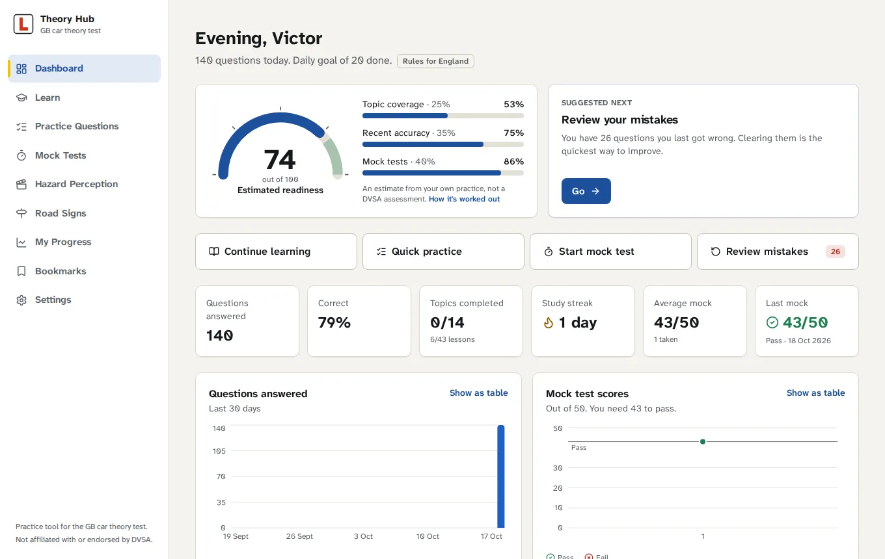
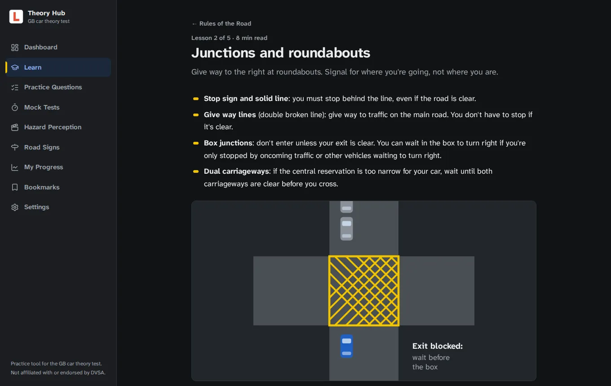
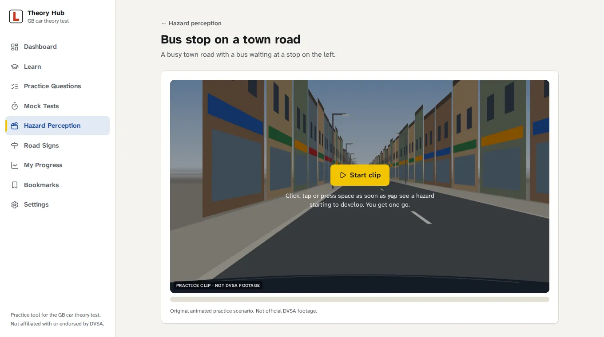

# UK Driving Theory Hub

A self-hosted app for practising the Great Britain car theory test (category B). It runs as a single container on my home k3s cluster, keeps everything in SQLite on a persistent volume, and works from a laptop or a phone on the same Wi-Fi.



What's in it:

- **Learn**: 14 topics, 43 lessons with diagrams, real UK road signs, quick checks and a 10-question quiz per topic. Rules that differ between England, Scotland and Wales are called out (the 20 mph default in Wales, Scotland's lower drink-drive limit and pavement parking ban).
- **Practice questions**: 233 original questions. Pick a topic and 10, 20, 30 or 50 questions. Answers are shuffled, and you get the explanation and Highway Code link straight after each one. Every answer is saved as you go.
- **Mock tests**: 50 questions, 57 minutes, pass mark 43, the same as the real test. Flag questions, change answers, question grid, auto-submit when time runs out, then a full review with a topic breakdown.
- **Hazard perception**: 10 animated practice clips (11 developing hazards, one clip has two) scored 5 to 1 like the real thing, including the zero score for pattern clicking. Licensed MP4 clips can be added later.
- **Road signs**: 175 official DfT sign images plus road markings, searchable, with flashcards that track which ones you didn't know.
- **Progress**: streak, daily activity, accuracy over time, mock history, weak and strong topics, and an estimated readiness score.
- Bookmarks, a "review my mistakes" mode, light and dark themes, and backup, restore and import in Settings.

<p>
  
  
</p>

## Before you rely on it

- It's an independent practice tool. It isn't made or endorsed by DVSA, and none of the questions are official DVSA revision questions. They're original, written from the [Highway Code](https://www.gov.uk/guidance/the-highway-code) and GOV.UK guidance, and each one links to its source.
- The hazard clips are animations drawn by the app, not filmed footage. They're good for practising timing and scanning, but real clips look very different, so use the official practice clips too.
- The test format was checked against GOV.UK on **18 October 2026**: 50 questions in 57 minutes with 43 to pass, three of them about a short silent video, and hazard perception with 14 clips, 15 hazards, 75 points and 44 to pass ([theory test](https://www.gov.uk/theory-test), [pass marks](https://www.gov.uk/theory-test/pass-mark-and-result)). The Highway Code content matches the version last updated on GOV.UK on 22 October 2025. Every question stores the date it was last verified.
- Northern Ireland has its own test and isn't covered.

## Running it locally

Needs Node 20.19 or newer.

```bash
npm install
npm run dev
```

That starts the API on port 3000 and the Vite dev server on 5173 with hot reload. Open http://localhost:5173. Vite also prints a `Network:` address you can open from your phone.

The database is created in `./data/theory.db` on first start, migrations run automatically, and the question bank, lessons and clips are loaded from the code. There's nothing to seed by hand, but these exist if you want them:

```bash
npm run db:migrate         # apply migrations
npm run db:seed            # migrate and load the built-in content
npm run content:check      # sanity check the content (add -- --links to check every URL)
```

Settings are environment variables, all optional. Copy `.env.example` to `.env` to change them.

| Variable | Default | What it does |
|---|---|---|
| `PORT` | `3000` | Port the server listens on |
| `HOST` | `0.0.0.0` | Bind address. Leave as 0.0.0.0 so other devices can reach it |
| `DATA_DIR` | `./data` | Where `theory.db` and `media/` live |
| `APP_TIMEZONE` | `Europe/London` | Used for "today" and streaks |
| `ADMIN_TOKEN` | not set | If set, backup, import and reset need it |
| `LOG_REQUESTS` | `true` | One log line per API request |

## Production build

```bash
npm run build
npm start
```

`npm run build` puts the client in `dist/client` and bundles the server into `dist/server`. `npm start` serves both on http://localhost:3000.

## Docker

```bash
docker build --build-arg APP_VERSION=1.0.0 -t driving-theory:1.0.0 .
docker run -d --name driving-theory -p 3000:3000 -v driving-theory-data:/data driving-theory:1.0.0
```

The image is `node:22-bookworm-slim` with only the production dependencies. It runs as uid 1000, handles SIGTERM (closes SQLite cleanly, usually in under a second), and has a `HEALTHCHECK` on `/healthz`. The database lives on the `/data` volume, so recreating the container doesn't lose anything.

## Kubernetes (k3s)

The manifests in `k8s/` create a namespace, ConfigMap, PVC (k3s `local-path`), a single-replica Deployment and a NodePort Service. A few choices worth knowing about:

- **One replica, `Recreate` strategy.** SQLite has one writer and the volume is ReadWriteOnce, so the old pod is stopped before the new one starts. Upgrades have a few seconds of downtime, which is fine for this.
- **Locked down pod**: non-root, read-only root filesystem (with an `emptyDir` on `/tmp`), all capabilities dropped, `RuntimeDefault` seccomp, no service account token. The namespace enforces the `restricted` Pod Security level.
- **Probes**: startup and readiness on `/readyz` (checks the database), liveness on `/healthz`.
- **NodePort 30081.** I'd normally use 30080, but `lab-calc-web` already has it on my k3s-lab cluster. Change `k8s/40-service.yaml` if you want something else.

### 1. Build the image and get it onto the node

There's no public registry involved. Build with Docker, then load the image straight into k3s's containerd:

```bash
docker build --build-arg APP_VERSION=1.0.0 -t driving-theory:1.0.0 .
docker save driving-theory:1.0.0 | sudo k3s ctr images import -
sudo k3s ctr images ls | grep driving-theory
```

The Deployment uses `imagePullPolicy: IfNotPresent`, so it uses that local copy and never tries Docker Hub.

If you can't use `sudo` on the node, a throwaway registry on localhost works too. containerd allows plain HTTP for `localhost`, so no registry config is needed:

```bash
docker run -d --name theory-registry -p 127.0.0.1:5000:5000 registry:2
docker tag driving-theory:1.0.0 localhost:5000/driving-theory:1.0.0
docker push localhost:5000/driving-theory:1.0.0
# after applying the manifests:
kubectl -n driving-theory set image deploy/driving-theory app=localhost:5000/driving-theory:1.0.0
```

This only works when the registry runs on the same machine as the k3s node, because `localhost` is resolved by the node.

### 2. Deploy

```bash
kubectl apply -f k8s/
kubectl -n driving-theory rollout status deploy/driving-theory
kubectl get pods -n driving-theory
kubectl get svc -n driving-theory
```

Files are numbered so the namespace is created first. The optional Ingress in `k8s/optional/` isn't applied by that command.

### 3. Open it

From anything on the home network, including phones on the Wi-Fi, use the node's LAN IP and the NodePort:

```
http://<node-ip>:30081
```

On my setup that's **http://192.168.0.55:30081**. To find the node IP:

```bash
kubectl get nodes -o wide        # INTERNAL-IP column
```

`localhost:30081` only works on the node itself. On another machine, `localhost` means that machine, not the cluster.

If you'd rather not use the NodePort, port-forward from your laptop instead:

```bash
kubectl -n driving-theory port-forward svc/driving-theory 8080:80
# then open http://localhost:8080
```

For a hostname instead of a port, there's an Ingress for `theory.home.arpa` in `k8s/optional/ingress.yaml`. `home.arpa` is reserved for home networks, so add it to your router's DNS or `/etc/hosts`.

### Checking on it

```bash
kubectl -n driving-theory logs deploy/driving-theory -f
kubectl -n driving-theory describe pod -l app.kubernetes.io/name=driving-theory
```

In k9s: `:ns` → `driving-theory`, then `l` on the pod for logs.

## Keeping it private

There's no login, so anyone who can reach the port can use it, reset it or download the database. On a home network that's usually fine, but:

- **Don't port-forward 30081 (or 80/443) on your router.** NodePorts listen on every node interface, so router port forwarding is the main way this ends up on the internet.
- Check your router doesn't have UPnP opening ports automatically.
- If other people use your Wi-Fi, set an admin token so only you can back up, import or reset:

  ```bash
  kubectl -n driving-theory create secret generic driving-theory-admin --from-literal=token="$(openssl rand -hex 16)"
  kubectl -n driving-theory rollout restart deploy/driving-theory
  kubectl -n driving-theory get secret driving-theory-admin -o jsonpath='{.data.token}' | base64 -d; echo
  ```

  Then paste the token in Settings → Data.
- For access away from home, use a VPN like Tailscale or WireGuard rather than opening ports.
- The app sends a strict Content Security Policy, loads nothing from external sites (fonts, signs and scripts are all bundled), and only links out to GOV.UK.

## Upgrading

Use a new image tag for every build. With `IfNotPresent`, reusing a tag means the node keeps running the old image it already has.

```bash
git pull
docker build --build-arg APP_VERSION=1.0.1 -t driving-theory:1.0.1 .
docker save driving-theory:1.0.1 | sudo k3s ctr images import -
kubectl -n driving-theory set image deploy/driving-theory app=driving-theory:1.0.1
kubectl -n driving-theory rollout status deploy/driving-theory
```

Then update the tag in `k8s/30-deployment.yaml` so the manifest matches what's running. Database migrations run automatically on start, and the built-in questions are updated in place. Questions removed from the code are deactivated rather than deleted, so your history stays intact. Take a backup first if the release notes mention schema changes.

## Backup and restore

**Backup from the app**: Settings → Download backup. It's a consistent copy taken while the app is running.

**Backup from the command line:**

```bash
POD=$(kubectl -n driving-theory get pod -l app.kubernetes.io/name=driving-theory -o jsonpath='{.items[0].metadata.name}')
kubectl -n driving-theory exec $POD -- node dist/server/cli.js backup /tmp/theory-backup.db
kubectl cp driving-theory/$POD:/tmp/theory-backup.db ./theory-backup-$(date +%F).db
```

**Restore**: copy the backup in as `restore.db` and restart. On start, the app checks it's a real SQLite file, moves the current database aside as `theory.db.before-restore-<timestamp>` and swaps the backup in.

```bash
kubectl cp ./theory-backup-2026-10-18.db driving-theory/$POD:/data/restore.db
kubectl -n driving-theory rollout restart deploy/driving-theory
kubectl -n driving-theory logs deploy/driving-theory | head -3   # "restored database from restore.db..."
```

With plain Docker it's the same idea: `docker cp backup.db driving-theory:/data/restore.db && docker restart driving-theory`.

The PVC uses `local-path`, so the data physically sits under `/var/lib/rancher/k3s/storage/` on the node. It survives pod restarts and redeploys, but **deleting the PVC or the namespace deletes the data** (the reclaim policy is `Delete`). Back up before `kubectl delete -f k8s/`.

## Adding licensed questions or hazard clips

See [docs/import-format.md](docs/import-format.md). In short: question packs are a JSON file you import from Settings or the CLI, and MP4 clips go on the data volume under `media/` with a small JSON file describing their scoring windows.

## How the readiness score works

It's an estimate to help decide what to do next, not an assessment.

```
readiness = 25% coverage + 35% recent accuracy + 40% mock tests
```

- **Coverage**: half from lessons completed, half from how many different questions you've answered per topic (the target is half of each topic's bank).
- **Recent accuracy**: correct rate over your last 100 practice answers, scaled down until you have 20, so a lucky 5 out of 5 doesn't count as 100%.
- **Mock tests**: average of your last 3 mock scores.

It's in `shared/readiness.ts` with tests in `tests/readiness.test.ts`.

## Tests

```bash
npm run typecheck
npm test
```

63 tests cover question selection, answer and mock scoring, pass/fail at 43, the 57-minute timer and auto-submit, practice sessions surviving a restart, hazard scoring and pattern detection, imports, backup and restore, and the main API flows against a real SQLite file.

## Project layout

```
client/            React app (Vite, Tailwind, shadcn-style components, Recharts)
  src/pages/       one file per screen
  src/hazard/      canvas renderer and player for the animated clips
  src/illustrations/  SVG diagrams used in lessons
server/src/        Express API, Drizzle schema, migrations, seeding, CLI
server/drizzle/    SQL migrations (generated with npm run db:generate)
shared/            exam rules, scoring, selection and readiness, used by both sides
content/           topics, lessons, questions, signs and hazard clips
k8s/               Kubernetes manifests
tests/             Vitest unit and API tests
scripts/           build, content checks and the sign image converter
```

## Credits and licences

- Traffic sign images are Crown copyright, from the [Department for Transport](https://www.gov.uk/guidance/traffic-sign-images), used under the [Open Government Licence v3.0](https://www.nationalarchives.gov.uk/doc/open-government-licence/version/3/). `scripts/prepare-signs.sh` rebuilds them from the official downloads.
- Highway Code rules are summarised from and linked to GOV.UK, Crown copyright, under the Open Government Licence v3.0.
- Questions, lessons, road marking drawings, illustrations and hazard clip animations are original to this project.
- UI font is [Atkinson Hyperlegible Next](https://www.brailleinstitute.org/freefont/) (SIL Open Font License), bundled locally.
